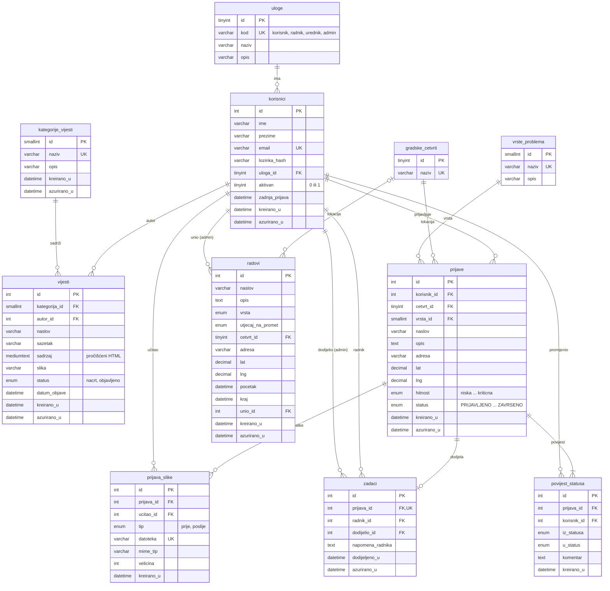
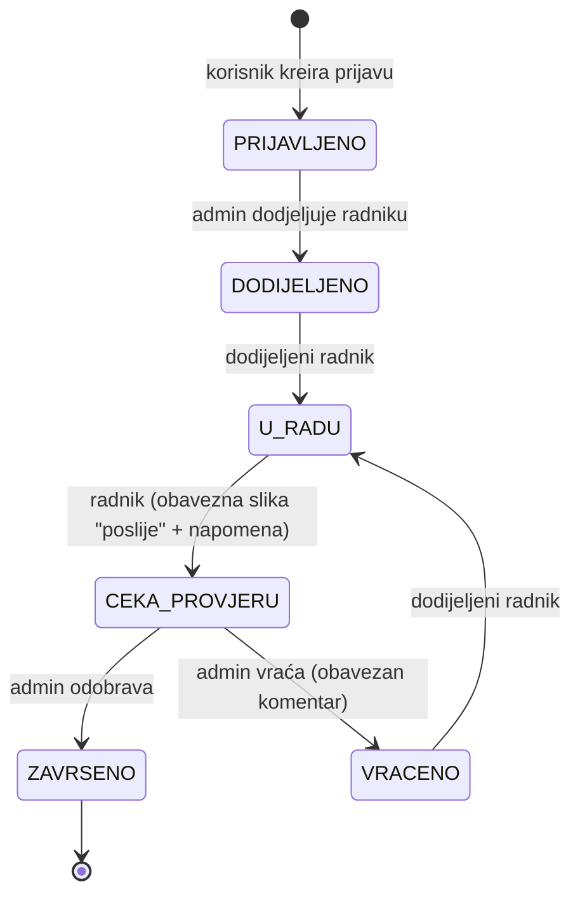

# ER dijagram – Zagreb Prijave

Dijagram je napisan u Mermaid formatu (GitHub i VS Code ga prikazuju kao sliku).
Za predaju se može izvesti u `docs/ER.png` preko https://mermaid.live (Actions → PNG).

Oznake: `PK` primarni ključ, `FK` strani ključ, `UK` jedinstveni ključ.
Kardinalnost: `||` točno jedan, `o|` nula ili jedan, `o{` nula ili više, `|{` jedan ili više.

## Pravila brisanja (ON DELETE)

| Strani ključ | Pravilo | Zašto |
|---|---|---|
| `korisnici.uloga_id → uloge` | RESTRICT | Uloga koju netko ima ne smije nestati. |
| `vijesti.kategorija_id → kategorije_vijesti` | RESTRICT | **Kategorija s vijestima se ne može obrisati** (zahtjev kolegija). |
| `vijesti.autor_id`, `prijave.korisnik_id`, `zadaci.radnik_id`, `zadaci.dodijelio_id`, `povijest_statusa.korisnik_id`, `prijava_slike.ucitao_id`, `radovi.unio_id → korisnici` | RESTRICT | Korisnici se **deaktiviraju, a ne brišu**, kako se ne bi izgubio trag tko je što napravio. |
| `prijave.cetvrt_id`, `prijave.vrsta_id`, `radovi.cetvrt_id` | RESTRICT | Šifrarnik koji se koristi ne smije se obrisati. |
| `prijava_slike`, `zadaci`, `povijest_statusa → prijave` | CASCADE | Ti zapisi nemaju smisla bez prijave. Ako admin obriše prijavu (npr. spam), brišu se i oni. Datoteke slika s diska briše PHP. |

Za sve strane ključeve vrijedi `ON UPDATE CASCADE`. Primarni ključevi se u praksi ne mijenjaju, pa je to samo sigurnosna mreža.

## Tok statusa prijave (state machine)

