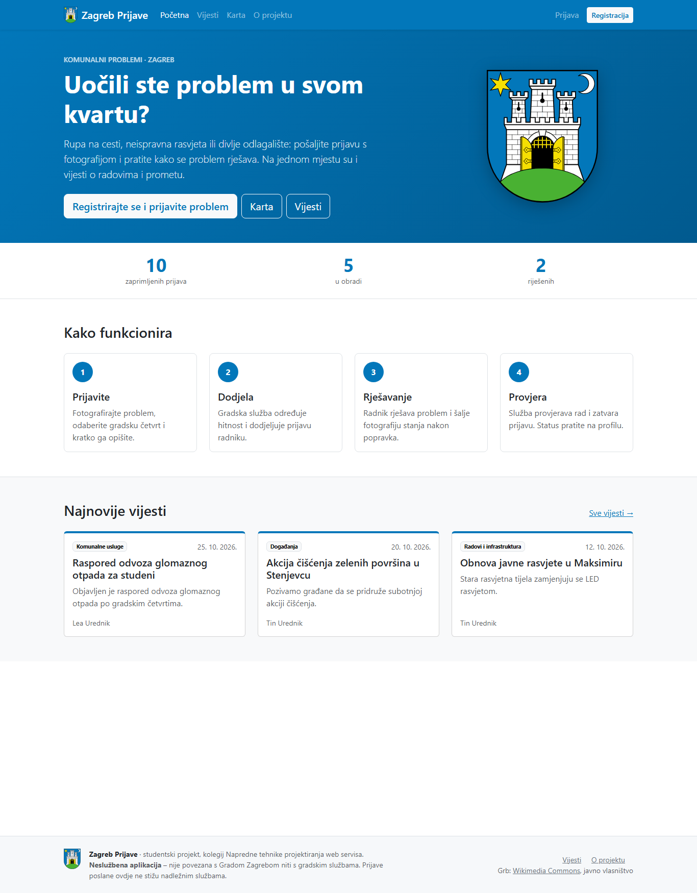
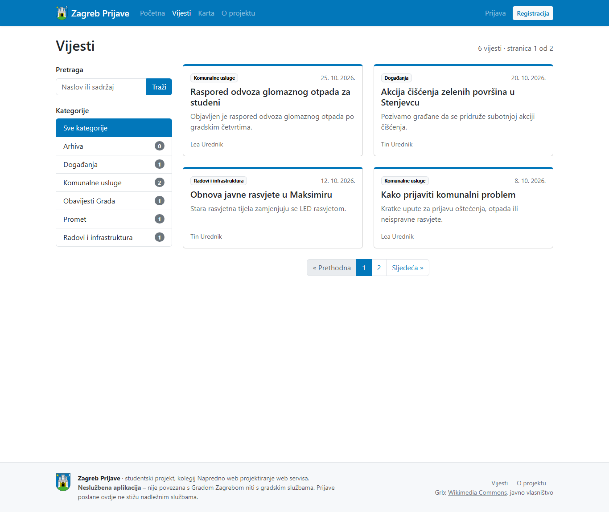
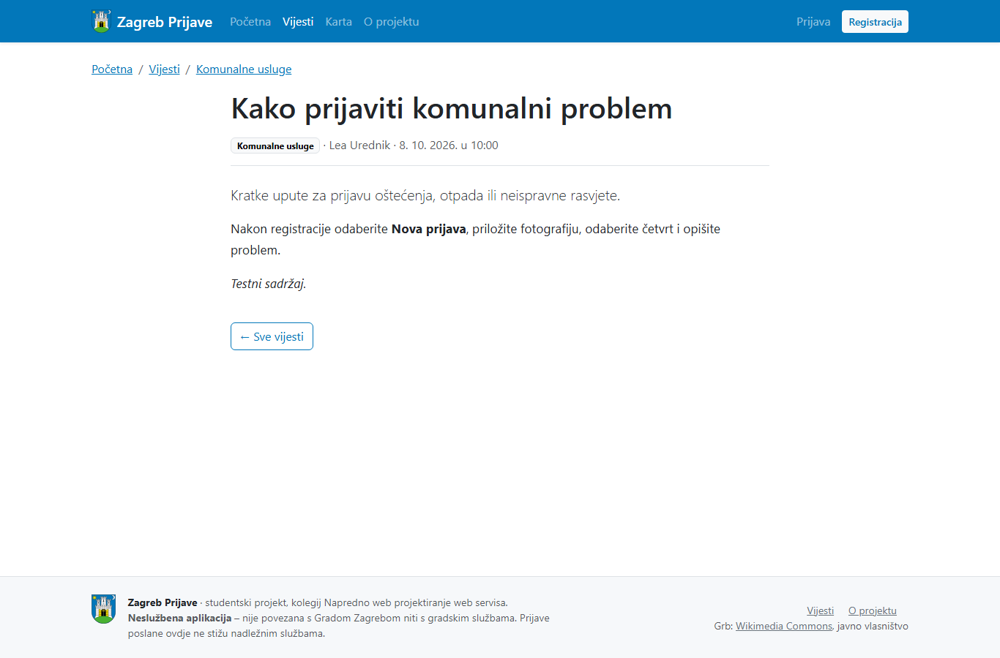
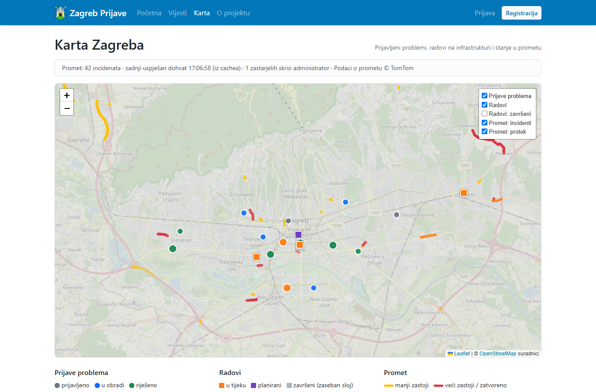
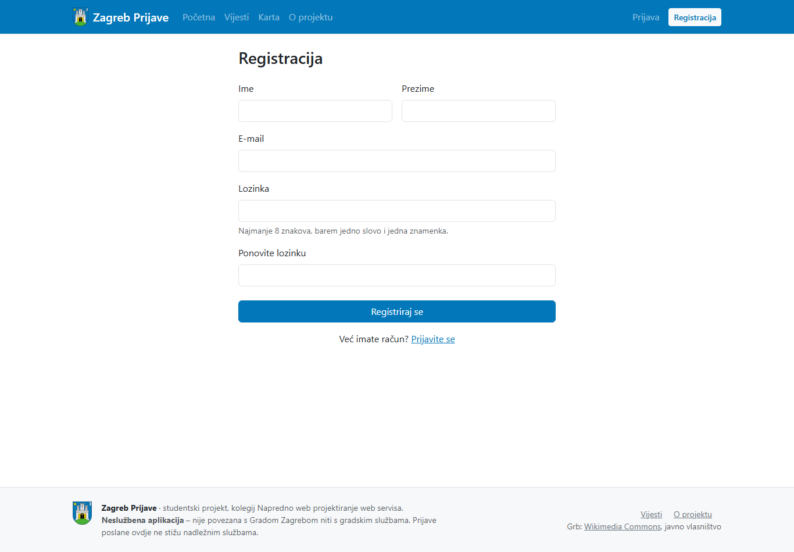
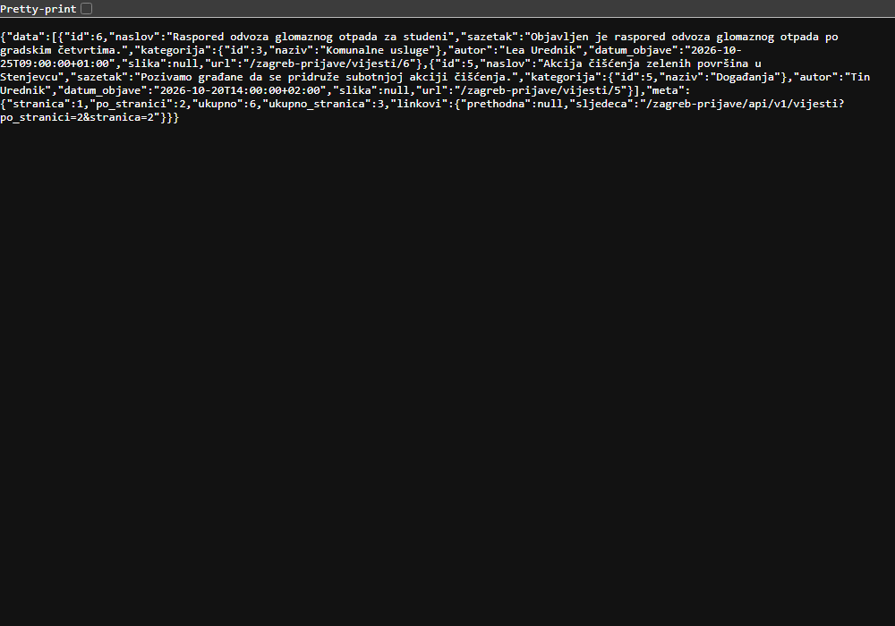
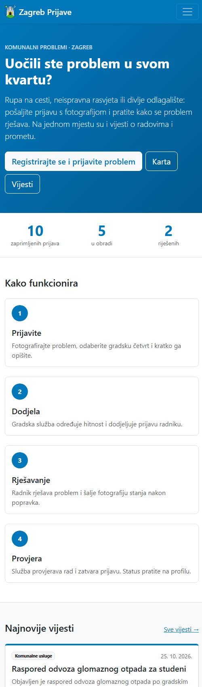
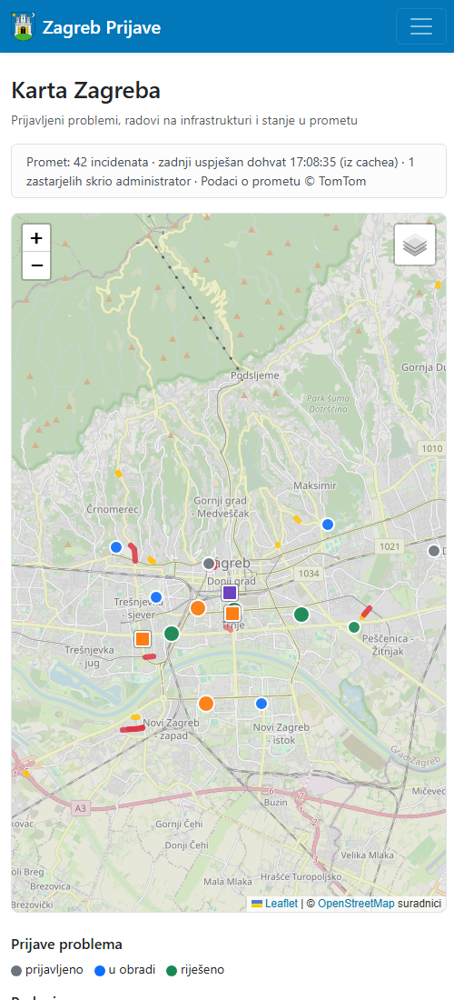

# Snimke zaslona

Snimke ključnih funkcija aplikacije (testni podaci iz `database/seed.sql`).

## Javni dio

| Snimka | Što prikazuje |
|---|---|
|  | **Početna** – opis aplikacije, broj prijava, „Kako funkcionira”, najnovije vijesti |
|  | **Vijesti** – pretraga, filtar po kategoriji s brojem vijesti, straničenje |
|  | **Detalj vijesti** – naslov, kategorija, autor, datum, sažetak i sadržaj |
|  | **Karta** – prijave, radovi i promet (TomTom) sa slojevima; vrijeme zadnjeg dohvata i broj skrivenih zastarjelih incidenata |
|  | **Registracija** |
|  | **REST API** – `GET /api/v1/vijesti?po_stranici=2` (JSON sa straničenjem) |

## Mobilni prikaz

| Snimka | Što prikazuje |
|---|---|
|  | Početna na uskom zaslonu – sažeti izbornik, sadržaj u jednom stupcu |
|  | Karta na uskom zaslonu – izbornik slojeva sklopljen |
